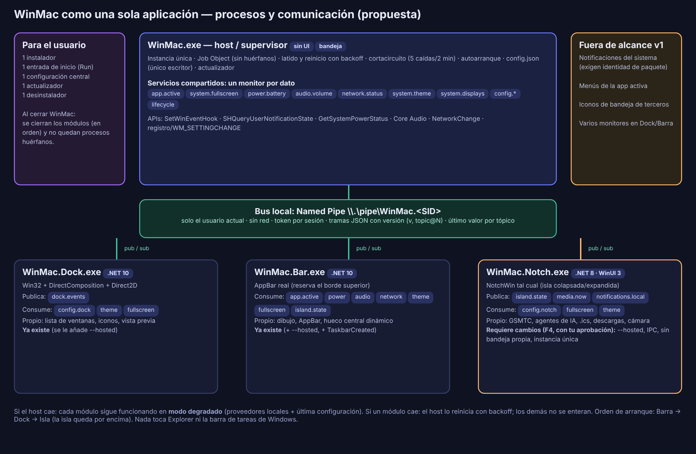

# Propuesta técnica: WinMac + NotchWin como una sola aplicación

Estado: **PROPUESTA, sin implementar.** No se ha copiado ni modificado código de NotchWin; no hay cambios en el Dock ni en la barra. Todo lo marcado [V] está por verificar antes de implementarse.
Fuentes inspeccionadas: este repositorio (docs/00 §3, docs/10–12, `src/`) y `PipeSick/notch-win` (commit `f67c4a3`, 11 commits, MIT).

## 0. Resumen y decisiones que necesito de ti
**Recomendación en una frase:** un **host/supervisor** `WinMac.exe` (único punto de entrada, instalación, configuración, autoarranque y actualización) que lanza los módulos **como procesos hijos** (Dock, Barra, NotchWin), los conecta por **un bus local sobre Named Pipes con mensajes JSON versionados**, y es el **único dueño** de la configuración y de los servicios de monitoreo que más de un módulo necesita. NotchWin entra primero **como componente externo fijado por versión** y se importa al repositorio (con historial) cuando su contrato con el host esté estable.

Esto **recupera la arquitectura que ya proponía docs/00 §3.1** (host/supervisor + procesos aislados + reinicio con backoff); Dock y Barra se hicieron como ejecutables separados, y esta propuesta los pone bajo ese supervisor.

| # | Decisión | Recomendación |
|---|---|---|
| D1 | ¿Dónde vive NotchWin a largo plazo? | Componente **externo fijado** (F4) → **importar con historial** al monorepo (F5) |
| D2 | Runtime | Hoy NotchWin = .NET 8 + WinUI 3 autocontenido; WinMac = .NET 10. Mantener **procesos autocontenidos** al inicio; unificar a .NET 10 al importar |
| D3 | ¿Puedo modificar NotchWin? | Sí, **solo en F4**, con tu aprobación explícita: modo `--hosted`, cliente IPC, sin bandeja propia, instancia única, ocultarse en pantalla completa |
| D4 | Instalador y actualizador | Instalador por usuario (Inno Setup o WiX) + Velopack (a evaluar, docs/00 §3.8) |
| D5 | Notificaciones del sistema | Requieren **identidad de paquete** (MSIX/sparse). Propongo **no** incluirlas en la v1 y limitar el tema a los eventos propios (descarga/temporizador/agente terminado) |
| D6 | Al cerrar WinMac | Cerrar todos los módulos (por defecto); la opción «dejar módulos abiertos» se pospone a F6 |
| D7 | UI de configuración central | Decidir tecnología en F6 (WinUI 3 vs WPF); en F2–F5 basta el menú de la bandeja + archivo de configuración |
| D8 | Marcas | «Dynamic Island» y «macOS/Tahoe» son marcas de Apple: usar «isla/notch» en nombres y textos de la interfaz, sin logos ni recursos de Apple |

## 1. Arquitectura recomendada
Principios: (1) **un solo producto para el usuario**, varios procesos por dentro; (2) **cada dato tiene un único propietario**, el resto se suscribe; (3) **un módulo caído no tumba a los demás** y puede funcionar degradado sin el host; (4) el host no tiene interfaz propia más que la bandeja; (5) sin privilegios elevados, sin puertos de red, sin tocar Explorer.

| Proceso | Rol | Tecnología | Estado hoy |
|---|---|---|---|
| `WinMac.exe` | Host/supervisor: instancia única, bandeja, configuración, bus IPC, servicios compartidos, ciclo de vida, actualizador | .NET 10, sin UI propia | **No existe** |
| `WinMac.Dock.exe` | Dock | .NET 10, Win32+DComp+D2D | Existe (`Dock.App`) |
| `WinMac.Bar.exe` | Barra superior | .NET 10, Win32+DComp+D2D | Existe (`Bar.App`) |
| `WinMac.Notch.exe` | NotchWin (isla) | .NET 8, WinUI 3 autocontenido | Repo aparte, sin tocar |
| `WinMac.Settings.exe` | Configuración central (bajo demanda) | por decidir (D7) | No existe |

Capas compartidas (librerías, no procesos): `WinMac.Ipc` (protocolo y transporte), `WinMac.Config` (modelo y migración), `WinMac.Platform.Windows` (proveedores del sistema ya escritos: ventanas, primer plano, pantalla completa, batería, volumen, red, tema).

## 2. Diagrama de procesos y comunicación


```
                       ┌────────────────────── WinMac.exe (host / supervisor) ──────────────────────┐
 inicio de sesión ───► │  instancia única · bandeja · Job Object · config central · actualizador    │
 (una entrada Run)     │  ┌─ Servicios compartidos (UN monitor por dato) ─┐   ┌─ Bus IPC (pipe) ─┐   │
                       │  │ app activa · ventanas* · pantalla completa    │──►│ tópicos con      │   │
                       │  │ batería · volumen · red · tema · pantallas    │   │ último valor     │   │
                       │  └───────────────────────────────────────────────┘   └───▲──────▲──────▲┘   │
                       └───────────────────────────────────────────────────────────┼──────┼──────┼────┘
          \\.\pipe\WinMac.<SID>  (solo el usuario actual, sin red, con token)    │      │      │
                                                                                  │      │      │
   ┌───────────── WinMac.Dock.exe ─────────┐  ┌──────── WinMac.Bar.exe ───────┐  ┌─┴──────┴──────┴──── WinMac.Notch.exe ─┐
   │ publica: dock.events                  │  │ consume: app.active, power,   │  │ publica: island.state, media.now,    │
   │ consume: config.dock, theme,          │  │   audio, network, theme,      │  │   notifications.local                │
   │   fullscreen, (windows*)              │  │   fullscreen, island.state    │  │ consume: config.notch, fullscreen,   │
   │ propio: lista de ventanas, iconos     │  │ propio: AppBar, dibujo        │  │   theme, lifecycle                   │
   └───────────────────────────────────────┘  └───────────────────────────────┘  │ propio: GSMTC, agentes de IA, .ics,  │
                                                                                 │   descargas, cámara, letra           │
   Cada módulo: mutex propio · latido al host · modo degradado local si el host cae └──────────────────────────────────────┘
   * «ventanas»: el Dock conserva su modelo propio hasta que se demuestre que mover el seguimiento al host aporta algo (F3).
```

## 3. Estrategia de integración de NotchWin
### 3.1 Qué se encontró (NotchWin)
- WinUI 3 **sin empaquetar** (`WindowsPackageType=None`), `net8.0-windows10.0.19041`, **Windows App SDK 1.6.250108002 autocontenido**, x64/arm64, `asInvoker`, PerMonitorV2. Se compila con **MSBuild de Visual Studio** (no `dotnet build`); la lógica (`NotchWin.Core`, 41 pruebas) es pura y compila en Linux.
- Ventana de la isla: siempre visible, `NOACTIVATE`/`TOOLWINDOW`, del tamaño de la píldora (o del panel expandido), pegada al borde físico superior (`OuterBounds`), **sin AppBar**, **una por monitor**.
- Datos: música por **GSMTC** (`Windows.Media.Control`, API oficial); agentes de IA, calendario (.ics), descargas (carpeta vigilada) y «notificaciones» propias **desde archivos locales**; letra opcional (única salida a internet: lrclib.net); cámara solo en su pestaña.
- **No tiene**: instancia única, autoarranque, detección de pantalla completa, actualizador. **Tiene** su propia bandeja y su propia ventana de Ajustes, y su configuración en `%LOCALAPPDATA%\NotchWin\settings.json` (incluye `AnthropicAdminApiKey` **en texto plano**).
- Estado declarado por su autor: interfaz **todavía no vista funcionando** en una máquina real; releases **sin firmar** (SignPath pendiente).

### 3.2 Opciones
| Opción | Descripción | A favor | En contra |
|---|---|---|---|
| **A. Componente externo fijado** | El instalador de WinMac incluye una versión concreta (hash) del binario de NotchWin; el host lo lanza en modo `--hosted` | Sin mover código; ritmos independientes; lo más rápido | Dos pipelines de release; hay que **firmar de nuevo** lo que se redistribuya |
| **B. Subárbol/submódulo** | `components/notch-win` dentro del monorepo | Un CI y una versión | Toolchain mixta (MSBuild+VS vs dotnet) dentro del mismo CI |
| **C. Importar con historial** | `git subtree`/`filter-repo` + `--allow-unrelated-histories`: **11 commits, trivial de conservar** | Historial y autoría intactos; una sola versión | Igual que B; exige decidir runtime (D2) |
| D. Reescribir en la pila de WinMac | — | — | **Descartada** (tu requisito) |

**Recomendación:** **A** hasta que el contrato del host esté estable (F4), luego **C** (F5). Nada se copia ahora. Comando previsto para C (no ejecutado): `git subtree add --prefix=components/notch-win https://github.com/PipeSick/notch-win main` (conserva los 11 commits; alternativa con `git filter-repo --to-subdirectory-filter`).

### 3.3 Cambios que NotchWin necesitará (F4, solo con tu aprobación)
1. `--hosted --pipe <nombre> --token-fd <h>`: modo integrado; sin ese flag sigue funcionando solo (compatibilidad con su repo actual).
2. **Sin bandeja ni ventana de Ajustes propias** en modo integrado (las gestiona el host).
3. Configuración leída/escrita **vía host** (sección `notch`); en modo solo, `settings.json` como hoy.
4. Cliente IPC (`WinMac.Ipc`, multi-target net8/net10): publica `island.state`, `media.now`, `notifications.local`; consume `config.notch`, `system.fullscreen`, `system.theme`, `lifecycle`.
5. **Instancia única** (mutex) y **ocultarse con pantalla completa**.
6. `WM_CLOSE`/`shutdown` ordenado en ≤ 3 s.
7. Conservar íntegros: isla colapsada/expandida, pestañas, animaciones, identidad visual.

### 3.4 Coordinación con la barra (evitar superposiciones)
La barra **reserva el espacio** (AppBar); la isla se dibuja encima del borde físico (ya lo hace). Hoy la barra deja libre un hueco central **fijo** (30 %). Con `island.state` (`estado`, `bounds` en píxeles, `monitor`) el hueco pasa a ser **dinámico**: ancho real de la píldora + margen, y al expandirse la barra cede el centro. Vigilar el **orden Z** (ambas «topmost»): la isla debe quedar encima; el host lanza la barra **antes** que la isla y la isla reafirma su posición al expandirse.

## 4. Diseño del protocolo IPC
### 4.1 Alternativas evaluadas
| Opción | Veredicto |
|---|---|
| **Named Pipes + JSON con prefijo de longitud** | **Elegida.** Local, sin puertos, ACL por usuario, `GetNamedPipeClientProcessId`, soportada en .NET 8 y 10 (y en Linux para pruebas) |
| JSON-RPC (StreamJsonRpc, MIT [V]) sobre pipes | Alternativa válida para req/res; aporta dependencia y menos control del *pub/sub*. Se puede adoptar después sobre el mismo transporte |
| gRPC sobre pipes | Pesado para este volumen de datos; rechazada |
| Sockets TCP/UDS en bucle local | **Rechazada** (puertos/ACL más débiles) |
| Memoria compartida (MMF) | Solo si hiciera falta un flujo de alta frecuencia; hoy no |
| `WM_COPYDATA` / COM | Atado a ventanas / más complejo; rechazadas |
| MessagePack/Protobuf | Binario más compacto; **innecesario** a ~decenas de mensajes/s. El campo `v` permite migrar |

### 4.2 Formato y versionado
Trama: `uint32 LE longitud` + JSON UTF-8. Sobre: `{ "v":1, "t":"hello|sub|unsub|pub|req|res|evt|ping|bye|err", "id":n, "topic":"app.active@1", "seq":n, "ts":ms, "data":{…} }`.
- **Negociación en `hello`**: `{ módulo, versiónMódulo, pid, protoMin, protoMax, capacidades, token }` → el host responde `{ proto, instancia, revisiónConfig }` o `err` (versión incompatible: el módulo funciona degradado y lo registra).
- **Compatibilidad**: campos desconocidos se ignoran; los cambios aditivos no suben versión; un cambio incompatible sube `topic@N` (el host publica ambas durante una versión) o `v`.
- **Semántica**: tópicos de **estado** conservan el último valor (el suscriptor nuevo lo recibe de inmediato) y se **fusionan** si el consumidor va lento; tópicos de **evento** no se conservan; cola acotada por suscriptor (se descarta lo antiguo; si un consumidor no avanza, se desconecta). `req/res` con tiempo límite para configuración y órdenes (`module.restart`, `config.set`).

### 4.3 Tópicos (cada uno con fuente real; sin integraciones ficticias)
| Tópico | Propietario | Fuente / API (documentada) | Consumidores reales hoy | Notas |
|---|---|---|---|---|
| `app.active` | Host | `SetWinEventHook(EVENT_SYSTEM_FOREGROUND)` + `GetWindowThreadProcessId` + resolución de identidad (ya existe) | Barra | Hoy la barra lo hace sola |
| `windows.state` | Dock (host en F3 si conviene) | `SetWinEventHook` + `EnumWindows` (ya existe en el Dock) | Dock | Se publica solo si otro módulo lo necesita |
| `system.fullscreen` | Host | `SHQueryUserNotificationState` (ya duplicado en Dock y Barra) | **Dock, Barra, Isla** (hoy la isla no lo hace) | Caso claro de duplicación a eliminar |
| `power.battery` | Host | `GetSystemPowerStatus` (+ `WM_POWERBROADCAST`/`PowerSettingRegister` para eventos [V]) | Barra | |
| `audio.volume` | Host | Core Audio `IAudioEndpointVolume` (+ `RegisterControlChangeNotify` en vez de sondeo [V]) | Barra | |
| `network.status` | Host | `NetworkChange` + `NetworkInterface` | Barra | Señal Wi-Fi: API WLAN, pendiente |
| `system.theme` | Host | clave `AppsUseLightTheme` + `WM_SETTINGCHANGE` | Dock, Barra, Isla | |
| `system.displays` | Host | `EnumDisplayMonitors`/`WM_DISPLAYCHANGE` | Dock, Barra, Isla | Barra/Dock hoy solo el principal |
| `media.now` | **Isla** | GSMTC (`Windows.Media.Control`) — ya implementado en NotchWin | (futuro: barra/Control Center) | Solo si hay consumidor |
| `island.state` | Isla | su propio estado/geometría | **Barra** (hueco dinámico) | |
| `dock.events` | Dock | acciones propias (lanzar/activar/anclar) | (futuro) | **Se define el tópico, no se implementa hasta que exista consumidor** |
| `notifications.local` | quien las genera | descarga/temporizador/agente terminado (propias) | Isla | **No** son notificaciones del sistema (D5) |
| `config.<sección>` | Host | `config.json` | todos | ver §5 |
| `lifecycle` | Host | supervisor | todos | `starting/stopping/shutdown` |

### 4.4 Seguridad del canal
- Nombre `\\.\pipe\WinMac.<SID del usuario>`; servidor con **ACL solo para el SID actual** (`PipeSecurity`/`CurrentUserOnly`) y **rechazo de clientes remotos** (fijarlo explícitamente [V]); sin puertos de red.
- **Token por sesión**: el host lo genera y lo entrega al hijo por **herencia de handle** (no por línea de comandos); el módulo lo presenta en `hello`. Además el host comprueba `GetNamedPipeClientProcessId` → la ruta del ejecutable debe estar dentro del directorio de instalación (y la firma Authenticode cuando exista).
- **Modelo de amenaza honesto**: protege frente a otros usuarios, a la red y a procesos accidentales; **no** frente a código malicioso que ya corra como el mismo usuario (puede hacer lo mismo sin el canal).
- Secretos (p. ej. `AnthropicAdminApiKey`) **no viajan por el bus** ni se guardan en `config.json`: ver §5.

### 4.5 Desconexiones
Latido `ping` cada 5 s (3 fallos = módulo colgado → reinicio controlado). Si el host cae, los módulos pasan a **modo degradado** (proveedores locales, última configuración válida) y reintentan conectar con *backoff*. Si un módulo cae, el host publica `lifecycle` y lo reinicia según su política (§6). Los mensajes en vuelo se descartan sin bloquear a nadie.

## 5. Modelo de configuración centralizada
`%APPDATA%\WinMac\config.json` — **solo el host escribe** (escritura atómica); los módulos piden cambios por IPC (`config.set { sección, parche, revisiónBase }`, concurrencia optimista) y reciben `config.<sección>` ya validado.
```json
{ "version": 1, "revision": 42,
  "app":     { "autostart": true, "language": "es", "theme": "system", "onExit": "closeModules", "updateChannel": "stable" },
  "modules": { "dock":  { "enabled": true, "restart": "backoff" },
               "bar":   { "enabled": true, "restart": "backoff" },
               "notch": { "enabled": true, "restart": "backoff" } },
  "dock":  { /* campos actuales de DockConfig (dock.json) */ },
  "bar":   { /* campos actuales de BarConfig (bar.json)  */ },
  "notch": { /* AppSettings de NotchWin: módulos de música/agentes, posición, pestañas, .ics, descargas, letra… */ } }
```
- **Activar/desactivar NotchWin** = `modules.notch.enabled`; el host inicia o detiene el proceso en caliente.
- **Migración (una vez, con copia de respaldo y sin borrar los originales)**: `dock.json`, `bar.json` y `%LOCALAPPDATA%\NotchWin\settings.json` → `config.json`. Hasta F3 los módulos siguen leyendo sus archivos actuales.
- **Secretos**: pasar `AnthropicAdminApiKey` (hoy en texto plano) a **DPAPI de usuario** (`ProtectedData`, `CurrentUser`) o Credential Manager; el host la entrega solo al módulo que la necesita, por solicitud, nunca por difusión.
- **Validación y límites**: esquema por sección; valores inválidos se reemplazan por los de fábrica con registro; tamaño máximo; `config.json` corrupto → copia anterior (`config.json.bak`).

## 6. Ciclo de vida de los módulos
Estados: `Disabled → Starting → Running ⇄ Degraded → Stopping → Stopped`; `Crashed → (espera backoff) → Starting`; `Failed` (cortacircuito abierto).
- **Arranque** (autoarranque = **una sola** entrada `HKCU\...\Run` → `WinMac.exe --background`, reversible): instancia única (`Local\WinMac.Host`) → leer config → abrir pipe → lanzar **Barra → Dock → Isla** (la isla al final para quedar encima). Un segundo `WinMac.exe` solo avisa al primero (`activate`) y sale.
- **Instancia única de módulos**: mutex por módulo; en producto, un módulo lanzado sin host se niega (salvo `--standalone` para desarrollo).
- **Reinicio**: backoff 1, 2, 4 … 30 s; **5 caídas en 2 min → `Failed`** (no se entra en bucle; aviso en la bandeja y botón «Reiniciar módulo»). Un módulo colgado (3 latidos perdidos) se cierra con `shutdown` y, solo como último recurso sobre **nuestros propios procesos**, se termina.
- **Parada ordenada** (cerrar WinMac): `lifecycle: shutdown` → cada módulo termina en ≤ 3 s en orden inverso (Isla → Barra [libera el AppBar con `ABM_REMOVE`] → Dock) → el host sale. Compatibilidad: los eventos de cierre actuales (`Local\WinMac.Dock.Quit`, `Local\WinMac.Bar.Quit`) se conservan como respaldo.
- **Sin procesos huérfanos**: los hijos se asignan a un **Job Object** con `JOB_OBJECT_LIMIT_KILL_ON_JOB_CLOSE`; si el host muere, Windows cierra a los hijos (y libera su AppBar). La opción «dejar módulos abiertos al salir» queda para F6 y exige otro mecanismo (readopción por mutex/pipe).
- **Desinstalación**: el desinstalador ejecuta `WinMac.exe --quit`, espera, y como respaldo pide el cierre de procesos que se ejecutan desde el directorio de instalación (Restart Manager/`CloseApplications` [V]); luego borra la clave `Run` y los archivos. Nunca se toca el área de trabajo ni la barra de tareas.
- **Explorer**: ningún paso lo reinicia ni lo cierra. Si `explorer.exe` se reinicia (mensaje `TaskbarCreated`), la barra debe **volver a registrar su AppBar** y la bandeja volver a crear su icono (**hoy la barra no lo hace: pendiente en F1**).

## 7. Riesgos técnicos
| # | Riesgo | Prob. | Impacto | Mitigación |
|---|---|---|---|---|
| R1 | NotchWin **nunca se ha visto funcionando** en pantalla real | Alta | Alto | Probarlo solo (sin host) en tu PC **antes** de F4; no integrar a ciegas |
| R2 | Smart App Control / SmartScreen bloquean binarios sin firma (todo el paquete, incluido NotchWin) | Alta | Alto | Estrategia de firma común (docs/00 §3.8) y volver a firmar lo redistribuido; documentar el obstáculo |
| R3 | Toolchain mixta (NotchWin exige MSBuild+VS; WinMac usa `dotnet` desde Linux) | Media | Medio | CI Windows con `msbuild` para NotchWin; Core de ambos sigue probándose en Linux |
| R4 | Tamaño del instalador por runtimes autocontenidos duplicados (.NET 8 + WinAppSDK + .NET 10 ×N) | Media | Medio | Medir; unificar a .NET 10 al importar (D2); recorte/compartir runtime |
| R5 | **Orden Z / superposición** isla–barra, y varios monitores | Media | Medio | `island.state`; lanzar la isla al final; prueba manual B12 |
| R6 | El host se vuelve punto único de fallo | Media | Alto | Módulos autosuficientes en modo degradado; el host es pequeño y sin UI; Job Object solo mata hijos, no deja el sistema inconsistente |
| R7 | Protocolo mal versionado rompe módulos al actualizar a mitades | Media | Medio | `protoMin/Max`, campos aditivos, un solo instalador/versión; prueba de compatibilidad N-1 |
| R8 | `UserNotificationListener` exige identidad de paquete | Alta | Medio | D5: fuera de la v1; MSIX/sparse como proyecto aparte |
| R9 | Secretos en texto plano (clave de Anthropic) | Media | Alto | DPAPI + no difundir por el bus (§5) |
| R10 | Proveedores de estado duplicados siguen sondeando | Media | Bajo | Retirarlos por fases (F3), con *fallback* local solo si el host no está |
| R11 | Explorer se reinicia y se pierde el AppBar/bandeja | Media | Medio | Escuchar `TaskbarCreated` (F1) |
| R12 | Procedencia/licencia (inspiración en Vorssaint, GPLv3) | Baja | Alto | NotchWin declara **reimplementación sin copiar código**; conservar esa declaración, no usar nombre ni recursos de Vorssaint, revisar el repo antes de redistribuir |
| R13 | Marcas de Apple en nombres y textos | Media | Medio | D8 |
| R14 | Fallo del WinUI 3 en el runner de CI (L1, causa sin investigar) podría repetirse con la UI de NotchWin o de Ajustes | Media | Medio | NotchWin ya usa WinUI 3 sin empaquetar: probarlo en tu PC (R1); no depender de WinUI para el host |

## 8. Plan incremental (cada fase se aprueba por separado; ninguna toca NotchWin antes de F4)
| Fase | Entrega | Criterio de salida |
|---|---|---|
| **F0** | Esta propuesta + decisiones D1–D8 | Tu aprobación |
| **F1** | `WinMac.Ipc` (tramas, sobre, *handshake*, versionado, servidor/cliente por pipes, token) y `WinMac.Config` (modelo, validación, migración) · barra: `TaskbarCreated` | Pruebas unitarias y de integración con pipes reales (también en Linux) verdes; **sin cambios de comportamiento** visibles |
| **F2** | `WinMac.exe` v0: instancia única, bandeja mínima, Job Object, lanza Dock+Barra (`--hosted`), latido, reinicio con backoff, parada ordenada, autoarranque opcional | Pruebas de ciclo de vida con procesos de mentira (cierre limpio, caída, cortacircuito, host muerto); sin huérfanos |
| **F3** | Servicios compartidos en el host (`system.fullscreen`, `app.active`, `power`, `audio`, `network`, `theme`, `displays`) y consumo desde Barra/Dock con *fallback* local | Un solo monitor por dato verificado; Dock y Barra siguen idénticos a la vista |
| **F4** | **NotchWin como componente**: cambios de §3.3 en su repo (con tu aprobación), binario fijado por hash, `island.state` → hueco dinámico en la barra | Isla integrada funciona en tu PC; sin superposición; apagar/encender desde WinMac |
| **F5** | **Importar NotchWin con historial** + CI único + instalador único + actualizador + firma | Instalar/actualizar/desinstalar sin huérfanos en una VM limpia |
| **F6** | Configuración central (UI), «dejar módulos al salir», notificaciones del sistema si D5 cambia | Criterios por definir |

## 9. Compatibilidad con lo ya desarrollado
- **Dock y Barra siguen siendo ejecutables independientes** (aislamiento); solo ganan `--hosted`. Se mantienen sus arquitecturas (núcleo puro + adaptador Windows), pruebas (Dock 110, Barra 23, Apps 25) y CI. **Cambia respecto a docs/00 §3.1**: allí Dock+Barra iban juntos en `winmac-shell.exe`; se quedan separados (coste: un dispositivo D3D y un fondo difuminado por proceso; medir en F2).
- **Se reutiliza sin reescribir**: `WindowTracker`, `WindowIdentityResolver`, `FullscreenWatcher`, `SystemProviders`, `ActiveAppProvider` pasan a una librería `WinMac.Platform.Windows` que usa el host y, como *fallback*, los módulos.
- **Configuración**: `dock.json` y `bar.json` siguen siendo válidos como entrada de la migración; el Dock deja de escribir su archivo cuando pase a la configuración central (F3+).
- **Cierre**: `--quit` y los eventos nombrados actuales se conservan como respaldo del cierre por IPC.
- **Arranque**: ya no habrá dos o tres accesos; el usuario solo ve `WinMac`.
- Sin cambios visuales en ninguna fase salvo el hueco dinámico de la barra (F4).

## 10. Repositorios y licencias (previo a fusionar)
| Tema | Hallazgo |
|---|---|
| Licencias | NotchWin: **MIT** (© «NotchWin contributors»). WinMac: Apache-2.0 **prevista; todavía no existe el archivo `LICENSE`** (hay que añadirlo). MIT es compatible con Apache-2.0; se conservan su `LICENSE` y su aviso en `THIRD_PARTY.md` |
| Dependencias de NotchWin | `Microsoft.WindowsAppSDK` 1.6.250108002 y `Microsoft.Windows.SDK.BuildTools`: licencias de Microsoft, redistribuibles según su documentación; **verificar el texto exacto antes de distribuir [V]**. Sin otras dependencias de terceros en `Core` |
| Dependencias de WinMac | Vortice.* (MIT) y APIs del sistema; sin otras |
| Procedencia | Sus autores declaran reimplementación sin código de Vorssaint (GPLv3) — ver R12 |
| Historial Git | **Fácil de conservar**: 11 commits (autores Felipe y Claude) → `git subtree`/`filter-repo` sin reescribir autoría |
| Distribución conjunta | Un instalador por usuario; NotchWin dentro del directorio de WinMac; una sola entrada en «Aplicaciones»; una sola clave de inicio |
| Actualizaciones | Un solo canal (Velopack a evaluar): actualiza el paquete completo con versiones coherentes de host+módulos+protocolo; NotchWin no se actualiza por su cuenta en modo integrado |
| Firma | Un único certificado/estrategia para todo lo que se distribuya (R2); el SignPath de NotchWin no cubre los binarios de WinMac |

## 11. Qué no se hará todavía
No se mueve ni copia código de NotchWin, no se crea el host, no se cambia el Dock ni la barra, no se publica nada. Los commits de esta propuesta quedan **locales** hasta tu autorización.
