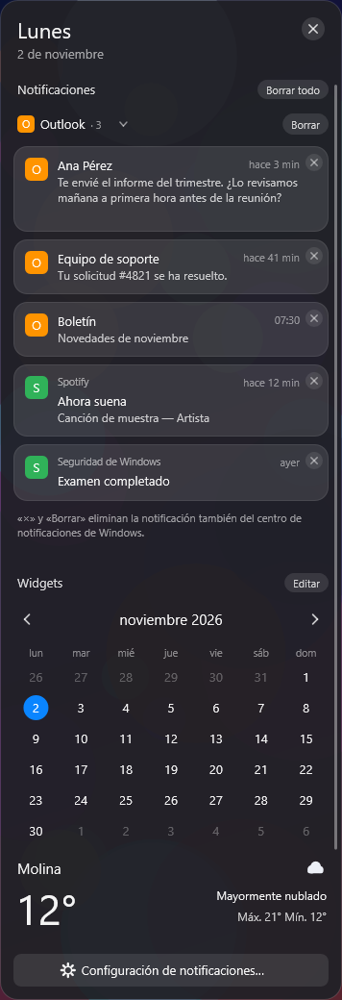
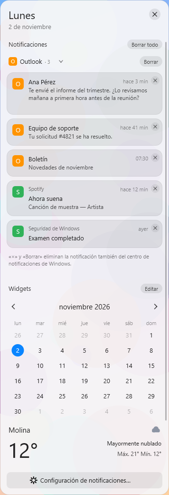
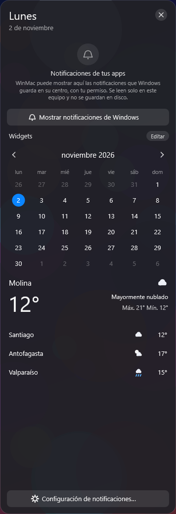

# Centro de Notificaciones (implementado; pendiente de validar en Windows físico)

Panel lateral inspirado en macOS. Se abre con el **reloj de la barra**, igual que en macOS, o con el mosaico «Notificaciones» del Control Center. Muestra las notificaciones **reales** que Windows guarda en su centro, agrupadas por app, y una sección de widgets: calendario, tiempo y batería.

Sustituye a la propuesta de [docs/19](19-notificaciones-propuesta.md). En el PC del usuario, la lectura funciona sin paquete y el evento de cambios no (ver la tabla siguiente).

## Medido en el PC del usuario (2026-11-02, Windows 11 build 26100, app sin paquete, `--selftest-system`)
| Qué | Resultado |
|---|---|
| Permiso (`GetAccessStatus`) | **Allowed** |
| Lectura (`GetNotificationsAsync`) | **funciona sin paquete**: 20 notificaciones de 5 apps en 281 ms, todas con texto |
| Iconos | solo con `AppDisplayInfo.GetLogo`: 4 de 20 (las apps Win32 no dan logo). Con el icono del Shell para su AUMID como respaldo (`44741f6`): **19 de 20**, lectura en 414 ms |
| Evento `NotificationChanged` | **no disponible** para la app sin paquete: `COMException 0x80070490` (elemento no encontrado). El panel relee cada 4 s **solo mientras está abierto** |

## Capturas (dibujo real, datos de MUESTRA)
Las dibujó el CI de Windows (runner virtual, WARP) con el pintor real, fuera de pantalla, a escala 1, sobre un fondo sintético. **Las notificaciones son de muestra**: validan el dibujo, no la lectura de Windows. Se obtienen con `WinMac.Bar.App --render-panel notifications|notifications-off`.

| Oscuro (grupo de Outlook desplegado) | Claro | Antes de activarlo |
|---|---|---|
|  |  |  |

## 1. Qué hace
| Función | Cómo | Estado |
|---|---|---|
| Notificaciones reales | `UserNotificationListener.GetNotificationsAsync(NotificationKinds.Toast)` | implementado; **medido**: lee las notificaciones reales en el PC |
| App de origen, nombre e icono | `UserNotification.AppInfo` (`AppUserModelId`, `DisplayInfo.DisplayName`, `DisplayInfo.GetLogo`, reducido a 32×32) | implementado; sin icono se dibuja la inicial |
| Título y texto | Textos de la plantilla `ToastGeneric`: el primero es el título y el resto, el cuerpo | sin texto se muestra «Notificación sin texto»; nunca se inventa nada |
| Hora | `UserNotification.CreationTime`: «ahora», «hace 5 min», «14:05», «ayer», «dd/MM» | implementado |
| Agrupar por app y orden cronológico | Grupos ordenados por su notificación más reciente; dentro de cada grupo, de la más reciente a la más antigua | implementado y probado |
| Grupos plegables | Un grupo de 2 o más se pliega como tarjetas apiladas; al tocarlo se despliega | implementado |
| Actualización | Evento `NotificationChanged` si Windows lo entrega a WinMac; si no, se relee cada 4 s **solo con el panel abierto** | implementado; qué vía se usa lo dice `--selftest-system` |
| Descartar una, borrar un grupo, borrar todo | Ver §3 | implementado |
| Abrir la app | Clic en la tarjeta: `shell:AppsFolder\<AUMID>`, solo si el Shell conoce esa app; si no, se dice | implementado |
| Widgets | Calendario (mes, navegación, día actual, eventos del .ics), Tiempo (servicio compartido) y Batería | implementado; orden y activación en Ajustes |

## 2. APIs y límites reales (sin inventar compatibilidad)
- **API usada:** `Windows.UI.Notifications.Management.UserNotificationListener` (WinRT pública). **No** se lee `wpndatabase.db`, no se automatiza la interfaz y no se interceptan notificaciones.
- **Permiso:** lo concede el usuario en Configuración → Privacidad y seguridad → Notificaciones. WinMac solo:
  - lo **consulta** con `GetAccessStatus`, sin preguntar nada;
  - lo **pide** con `RequestAccessAsync` cuando el usuario pulsa «Permitir acceso…».

  Si está denegado, WinMac no puede cambiarlo: el panel ofrece abrir esa página de Configuración.
- **Dos consentimientos:** además del permiso de Windows, WinMac **no lee nada** hasta que el usuario pulsa «Mostrar notificaciones de Windows» (ajuste `notificationsFromWindows`, **apagado por defecto**).
- **Historial:** solo existe lo que sigue en el centro de Windows (Win+N). Lo que el usuario borró allí, lo que caducó y lo que Windows no guarda (p. ej. las apps con «Mostrar en el centro de notificaciones» desactivado) **no se puede recuperar** con ninguna API pública.
- **Apps empaquetadas (MSIX / Store):** aparecen con su nombre e icono.
- **Apps Win32:** aparecen si usan las notificaciones *toast* de Windows (las que salen en Win+N). Algunas no exponen nombre o icono: se agrupan por lo que haya y se dibuja la inicial.
- **Apps con mecanismo propio** (ventanas emergentes propias, globos antiguos de la bandeja, notificaciones que solo viven dentro de la app): **no pasan por el centro de Windows**, así que WinMac **no puede verlas**.
- **Tipo de notificación:** solo se leen las *toast*. Los iconos de insignia y los mosaicos no son notificaciones del centro.
- **Activar la notificación concreta** (abrir el mensaje exacto, pulsar los botones de la notificación) **no es posible** desde otra app: Windows no lo expone. Lo más cercano es abrir la app de origen.
- **Evento de cambios:** para apps sin paquete, Windows puede no entregar `NotificationChanged` (la suscripción lanza una excepción). Entonces se relee cada 4 s, solo con el panel abierto. Con el panel cerrado no se lee nada.
- **Identidad de paquete:** si `GetNotificationsAsync` fallara sin paquete, el panel lo dice («No se pudieron leer…» con el código) y ofrece el centro de Windows. La alternativa sería un paquete disperso (identidad con ubicación externa), que exige firmar y registrar: queda fuera de este trabajo (ver docs/19 §4.5).

## 3. Ocultar en WinMac frente a eliminar en Windows
El ajuste **«Borrar también en Windows»** (`notifRemoveFromWindows`, activado por defecto) decide qué hacen «×», «Borrar» y «Borrar todo». El pie del panel lo dice siempre.

| Ajuste | «×» en una tarjeta | Botón del grupo | Botón de la sección |
|---|---|---|---|
| Activado | `RemoveNotification(id)`: desaparece también de Win+N | «Borrar»: elimina cada notificación del grupo en Windows | «Borrar todo»: `ClearNotifications()` tras **confirmación** |
| Desactivado | Solo se oculta en WinMac durante la sesión; sigue en Win+N | «Ocultar» | «Ocultar todo», sin confirmación porque no se borra nada |

Si Windows rechaza una eliminación, la notificación **vuelve a aparecer** con el motivo. Nunca se muestra como borrada sin estarlo.

## 4. Privacidad y recursos
- El contenido vive **solo en memoria** del proceso de la barra. No se escribe en disco, ni en la configuración, ni en los registros: las pruebas verifican que el registro no contiene títulos ni textos. Los iconos también se guardan solo en memoria (máximo 128).
- Desactivar «Mostrar notificaciones de Windows» borra de memoria todo lo leído.
- Hay un solo almacén por proceso de barra, compartido por todos los monitores, sin procesos ni servicios nuevos. La barra lo libera al cerrar: deja de escuchar el evento y vacía los iconos.
- Sin administrador. No se cambia ninguna política de Windows.

## 5. Interfaz e integración
- **Dónde se abre:** en el borde derecho del **monitor cuyo reloj se pulsó**, a su DPI, desde justo debajo de la barra hasta el final del área de trabajo. No tapa la barra ni la barra de tareas.
  - Ancho: una cuarta parte del monitor, entre 300 y 372 DIP.
  - Si el contenido no cabe, el centro se desplaza; el encabezado (día, fecha y «×») y el pie (Configuración de notificaciones) quedan fijos.
- **Cómo se cierra:** con Esc, con la «×», volviendo a pulsar el reloj o haciendo clic fuera del panel (pierde el foco, igual que los demás paneles).
  - Mientras hay un cuadro de confirmación abierto, el panel no se cierra.
  - Si se cierra con Esc, la «×» o el reloj, el foco vuelve a la ventana que lo tenía.
- **Animación:** entra deslizándose en 220 ms y sale en 160 ms (curva «ease-out»).
  - Solo se mueve la capa de DirectComposition: no se redibuja en cada fotograma, y el bucle espera 8 ms entre pasos solo mientras dura.
  - Si Windows tiene desactivadas las animaciones, aparece sin deslizarse.
- **Vidrio:** fondo de pantalla desenfocado tras el panel, la misma técnica que la barra. Se calcula **una vez por apertura**.
  - No desenfoca en vivo las ventanas que hay detrás: sería caro.
  - Con fondo «Transparente» o sin fondo de pantalla, la tarjeta es opaca.
- **Tema:** claro u oscuro según la barra.
- **Dock:** el panel va a la derecha y el Dock abajo, en el centro. Con un Dock muy ancho pueden solaparse mientras el panel está abierto; nunca de forma permanente.
- **Sin iconos nuevos:** se usan el reloj y el mosaico existente del Control Center. Con `notificationCenter = false`, el reloj vuelve a abrir el calendario y el mosaico, el centro de Windows, como antes.

## 6. Cómo probarlo en Windows físico (seguro para una sesión remota con Sunshine/Moonlight)
Nada de esto cambia la resolución, el monitor principal, las pantallas, la red ni el audio, ni cierra la sesión.

1. Compila la rama y ejecuta la sonda. Solo lee: no pide permiso, no muestra contenido y no borra nada:

   ```powershell
   [Console]::OutputEncoding = [Text.Encoding]::UTF8
   .\dist\diag\WinMac.Bar.App.exe --selftest-system | Tee-Object -FilePath diag-notificaciones.txt
   ```

   En la sección «Centro de Notificaciones» verás tres cosas:
   - el **permiso**;
   - la **lectura**: cuántas notificaciones y de cuántas apps (si falla, sale `[FALLO]` con el código);
   - si llega el **evento de cambios**.
2. Abre WinMac y **pulsa el reloj**. Debe entrar el panel lateral por la derecha del monitor donde pulsaste.
3. Pulsa «Mostrar notificaciones de Windows» y, si lo pide, «Permitir acceso…».
4. Genera una notificación propia sin tocar el sistema, por ejemplo con un recordatorio de la app Reloj o un correo de prueba. Comprueba que aparece agrupada con su app, su icono y su hora.
5. Prueba la «×» con «Borrar también en Windows» activado y desactivado (Ajustes → Notificaciones). Compara con Win+N.
6. Cierra con Esc, con la «×», con el reloj y con un clic fuera del panel. Repite en el otro monitor.
7. Si tienes dos monitores con escalas distintas, abre el panel en cada uno: debe verse nítido y con el alto correcto en ambos.

## 7. Pruebas automáticas
`WinMac.Bar.Core.Tests/NotificationCenterTests.cs` (25 pruebas) cubre:
- agrupación y orden;
- notificaciones sin título o sin texto, apps sin id, sin nombre o sin icono;
- permiso sin decidir, concedido y denegado;
- errores de la API (lanzar al consultar el permiso o al leer);
- ocultar frente a eliminar y vuelta atrás si Windows rechaza;
- borrar grupos y todo, con confirmación;
- evento frente a relectura;
- una sola lectura a la vez;
- desactivar y descartar resultados viejos;
- abrir la app;
- configuración de widgets y su orden;
- batería en sobremesa;
- encabezado y pie fijos;
- zonas pulsables;
- geometría en varios monitores y DPI;
- animación;
- apertura desde el reloj y el Control Center.

`WinMac.Host.Core.Tests` comprueba la página de Ajustes y las acciones de los widgets.

Son pruebas con una fuente simulada: **no demuestran** que Windows entregue notificaciones a WinMac. Eso se mide con el paso 1 de §6. El CI de Windows dibuja el panel fuera de pantalla con datos de muestra (`panel-notifications-*.png`), lo que valida el dibujo, no la API.

## 8. Riesgos e incompatibilidades
| Riesgo | Efecto | Qué hace WinMac |
|---|---|---|
| `GetNotificationsAsync` exige identidad de paquete en otras versiones de Windows (en el PC del usuario NO la exige) | «No se pudieron leer…» con el código | lo dice y ofrece Win+N; la solución sería un paquete disperso, fuera de alcance |
| Sin evento de cambios para apps sin paquete (**medido**: 0x80070490) | Las notificaciones nuevas tardan hasta 4 s en aparecer | relectura solo con el panel abierto |
| Apps Win32 sin nombre o icono | Grupo con el AUMID o «Aplicación desconocida» e inicial | sin inventar nada |
| Windows no activa una notificación concreta desde fuera | El clic abre la app, no el mensaje | documentado |
| El vidrio usa el fondo de pantalla, no lo que hay detrás | Sobre ventanas, el desenfoque no las refleja | igual que la barra; opaco si no hay fondo |
| Robo de foco | El panel toma el foco al abrirse (necesario para Esc y para el clic fuera) | al cerrarse con Esc, «×» o reloj devuelve el foco |
| Dock muy ancho | Solape temporal | solo mientras el panel está abierto |
